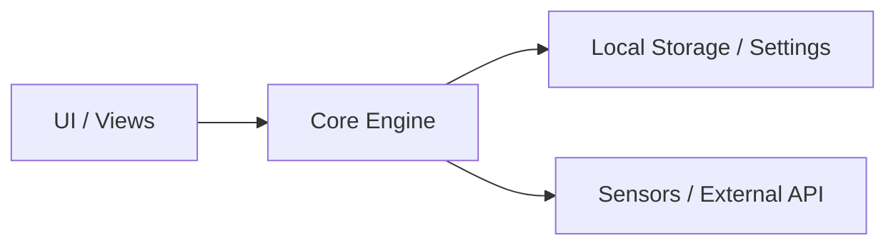
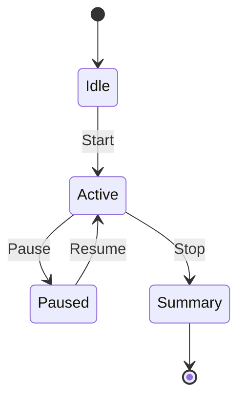

# Mermaid Diagram Guidelines

Use Mermaid diagrams in `docs/ARCHITECTURE.md` and `README.md` to explain architecture, data flow, and state transitions cleanly.

## Rules for Clean Diagrams

1. Keep each diagram focused on one concept (System Context, Data Flow, or State Machine).
2. Cap at 8 to 12 nodes per diagram; split larger systems into overview + subsystem diagrams.
3. Wrap labels containing special characters (parentheses, colons, slashes) in double quotes: `A["Garmin CIQ App (Monkey C)"]`.
4. Avoid complex inline CSS styling that breaks between GitHub light and dark themes.

## Starter Patterns

### Architecture Flow

### State Machine

