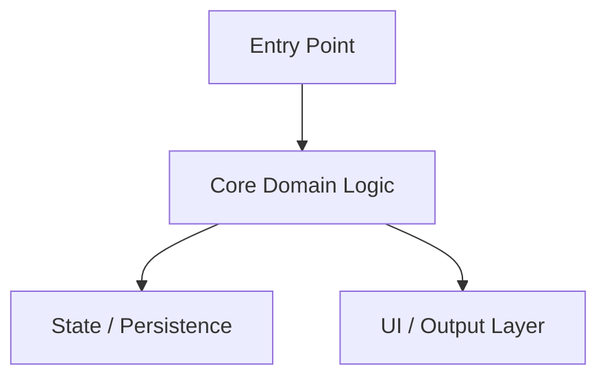

# Architecture Overview

## System Summary

<Concise summary of the system's architectural pattern, runtime constraints, and primary responsibilities.>

## High-Level Diagram

## Module Breakdown

| Module / Directory | Responsibility | Key Files |
| :--- | :--- | :--- |
| `<module-1>` | `<What it owns>` | `<path/to/file>` |
| `<module-2>` | `<What it owns>` | `<path/to/file>` |

## Data Flow & State Lifecycle

1. **Input / Trigger**: <How events or data enter the system>
2. **Processing**: <How core logic transforms or validates state>
3. **Persistence / Output**: <Where state is saved and how UI or responses render>

## Key Design Decisions & Constraints

- **<Decision 1>**: <Why this approach was chosen and what trade-off it accepts>
- **<Constraint 1>**: <Memory, latency, platform API, or device compatibility constraint>
