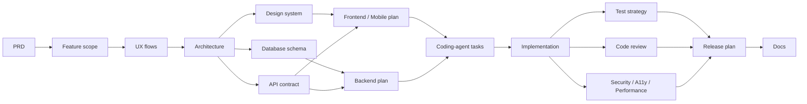

# Web & App Dev Skills

A collection of 22 platform-agnostic `SKILL.md` skills that guide AI assistants and coding agents through the full life of a web or mobile product: from a rough idea, to specifications, to implementation planning, to quality checks, to release and maintenance.

> **Status: v0.1.0 (experimental).** The skills are written to be tool-independent, but they have not yet been systematically evaluated across different AI tools. Expect rough edges and please report them.

## What this is

Each skill is a single Markdown file that gives an AI a clear role, principles, a step-by-step workflow, and a required output structure for one kind of task, for example writing a PRD, designing a database schema, reviewing code, or planning a release.

All skills share the same ideas:

- **Evidence over invention.** Facts, assumptions, recommendations, and open questions are kept separate. Skills never claim something was tested, run, or verified unless it actually was.
- **Traceability.** Screens, endpoints, tables, and tests trace back to requirements.
- **Right-sized output.** No speculative features, premature abstraction, or unnecessary infrastructure.
- **Tool independence.** No skill depends on a specific vendor, product, or tool.

## The skills

### Planning

| Skill | Use it to |
|---|---|
| [`prd-generator`](skills/prd-generator/SKILL.md) | Turn ideas and notes into testable, implementation-ready PRDs |
| [`app-feature-scope-planner`](skills/app-feature-scope-planner/SKILL.md) | Prioritize features, define the MVP, and plan milestones |
| [`app-ux-flow-specifier`](skills/app-ux-flow-specifier/SKILL.md) | Specify user flows, sitemap, screens, and navigation |

### Architecture and design

| Skill | Use it to |
|---|---|
| [`app-architecture-designer`](skills/app-architecture-designer/SKILL.md) | Define modules, boundaries, dependencies, and data flow |
| [`web-design-system-architect`](skills/web-design-system-architect/SKILL.md) | Specify design tokens, components, and UI patterns |
| [`database-schema-designer`](skills/database-schema-designer/SKILL.md) | Design schemas, constraints, indexes, and migrations |
| [`api-contract-designer`](skills/api-contract-designer/SKILL.md) | Define endpoints, schemas, errors, and OpenAPI contracts |

### Implementation

| Skill | Use it to |
|---|---|
| [`frontend-implementation-planner`](skills/frontend-implementation-planner/SKILL.md) | Plan routes, components, state, and API integration |
| [`backend-implementation-planner`](skills/backend-implementation-planner/SKILL.md) | Plan services, business logic, persistence, and workflows |
| [`mobile-app-implementation-planner`](skills/mobile-app-implementation-planner/SKILL.md) | Plan native or cross-platform mobile apps |
| [`design-system-implementer`](skills/design-system-implementer/SKILL.md) | Implement tokens, theming, and component libraries in code |
| [`ai-coding-agent-task-planner`](skills/ai-coding-agent-task-planner/SKILL.md) | Break specs into dependency-aware tasks for coding agents |

### Quality

| Skill | Use it to |
|---|---|
| [`test-strategy-planner`](skills/test-strategy-planner/SKILL.md) | Plan risk-based tests traced to acceptance criteria |
| [`code-review-auditor`](skills/code-review-auditor/SKILL.md) | Review code and verify implementations against specs |
| [`security-privacy-auditor`](skills/security-privacy-auditor/SKILL.md) | Review security and privacy risks defensively |
| [`accessibility-performance-auditor`](skills/accessibility-performance-auditor/SKILL.md) | Audit accessibility, performance, and technical SEO |
| [`debugging-root-cause-analyst`](skills/debugging-root-cause-analyst/SKILL.md) | Find root causes and apply minimal, verified fixes |

### Release and maintenance

| Skill | Use it to |
|---|---|
| [`devops-release-planner`](skills/devops-release-planner/SKILL.md) | Plan CI/CD, environments, rollback, and releases |
| [`legacy-refactor-migration-planner`](skills/legacy-refactor-migration-planner/SKILL.md) | Plan safe refactors, upgrades, and migrations |
| [`repo-onboarding-agents-md-generator`](skills/repo-onboarding-agents-md-generator/SKILL.md) | Generate agent and contributor context files for a repo |
| [`technical-docs-writer`](skills/technical-docs-writer/SKILL.md) | Write READMEs, guides, API docs, ADRs, and changelogs |

### AI features

| Skill | Use it to |
|---|---|
| [`ai-feature-eval-designer`](skills/ai-feature-eval-designer/SKILL.md) | Specify and evaluate LLM-powered features |

## Suggested workflow

The skills are independent, but they are designed to feed each other:



Use these as needed at any point: `debugging-root-cause-analyst` when something breaks, `legacy-refactor-migration-planner` for existing code, `repo-onboarding-agents-md-generator` when an agent needs to understand a repository, and `ai-feature-eval-designer` when a feature uses an LLM.

You do not need all 22. Pick the ones that match your task.

## Installation

Each skill lives in its own folder as `skills/<skill-name>/SKILL.md`. Choose the method that fits your tool.

**1. As a skill folder (tools that support `SKILL.md` skills).**
Copy the folders you want from `skills/` into your tool's skills directory. The location differs between tools, so check your tool's documentation.

**2. As custom instructions or a system prompt.**
Open a `SKILL.md`, copy everything below the frontmatter, and paste it into your assistant's system prompt, project instructions, or custom instructions. The `name` and `description` fields in the frontmatter are metadata for tools that load skills automatically; they are not needed when pasting.

**3. As a reference for a coding agent.**
Keep the folder in your repository and point your agent's instructions file to the skill it should follow for a given task, for example "Follow `skills/test-strategy-planner/SKILL.md` when planning tests."

**4. Manually, per conversation.**
Paste the skill content at the start of a conversation, then describe your task.

## Usage example

After installing, describe your task naturally. For tools that trigger skills automatically, the `description` field in each skill's frontmatter tells the tool when to use it.

> "I want to build a habit tracker app. Help me write a PRD."

> "Review this pull request against the PRD and tell me whether the agent actually finished the task."

> "Why is my site slow on mobile?"

## Repository structure

```text
.
├── README.md
├── CONTRIBUTING.md
├── CHANGELOG.md
├── LICENSE
├── templates/
│   └── SKILL_TEMPLATE.md
└── skills/
    ├── prd-generator/
    │   └── SKILL.md
    ├── app-feature-scope-planner/
    │   └── SKILL.md
    └── ...
```

## Design conventions

Every skill follows the same structure so that they are predictable and easy to maintain:

1. A role and responsibility statement.
2. A **Platform-Agnostic Operation** section.
3. **Core Principles**.
4. A numbered **Workflow**.
5. A **Required Output Structure**.
6. **Scope Boundaries**, **Communication Style**, and a **Final Quality Standard**.

## Limitations

- The skills guide an AI; they do not replace engineering judgment, penetration testing, accessibility testing with real assistive technology, legal review, or professional compliance assessment.
- Output quality depends on the AI tool and the information you provide.
- The skills have not yet been benchmarked across tools. Evaluation results and test prompts are welcome contributions.

## Contributing

Contributions are welcome: new skills, fixes, clearer instructions, and evaluation prompts. Please read [CONTRIBUTING.md](CONTRIBUTING.md) first, and use [`templates/SKILL_TEMPLATE.md`](templates/SKILL_TEMPLATE.md) when proposing a new skill.

## Changelog

See [CHANGELOG.md](CHANGELOG.md).

## License

Released under the [MIT License](LICENSE).
